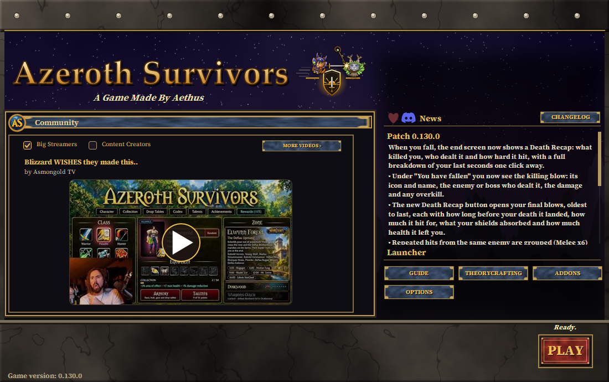
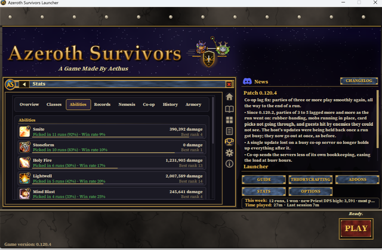
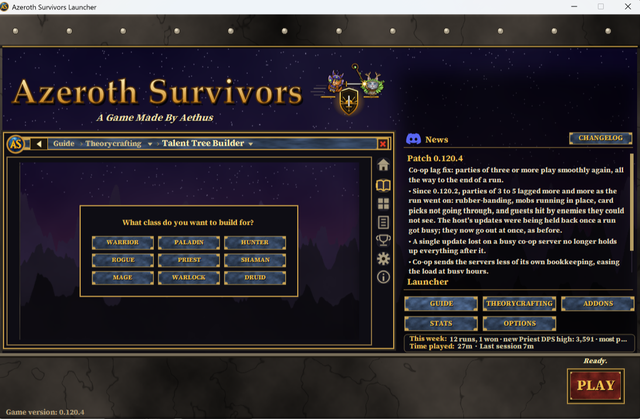
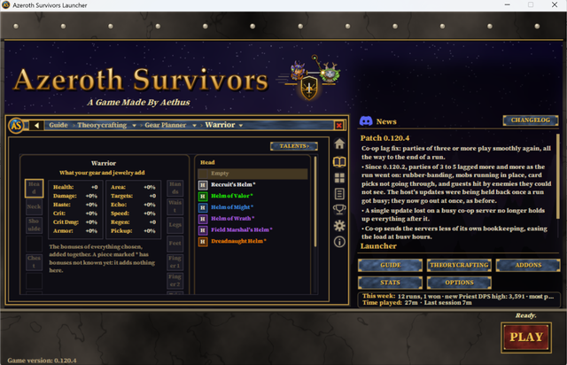

# Azeroth Survivors Launcher

A free, community-made Windows launcher for **[Azeroth Survivors](https://wow.aethus.pl/)**, the survivors-style game made
by **Aethus**. It gets the game onto your PC, keeps it up to date, manages your addons, teaches new players how the
game works, gives you tools to plan builds, and brings the community's videos to your home screen.

This is a fan project. It is not made by Aethus, and it is not affiliated with or endorsed by Blizzard Entertainment.
The launcher does not contain or host the game: it downloads it from the game's own download hosts. See
[CREDITS.md](CREDITS.md) for where everything comes from.

**[Download the launcher](https://github.com/Slimmy25/Azeroth-Survivor-Launcher/releases/latest)**: one file,
`Azeroth Survivors Launcher.exe`. Put it in the folder where the game is, or where you want it installed. It needs
nothing else: it runs on the .NET Framework 4.8 that comes with Windows 10 and 11.

<table>
  <tr>
    <td align="center"> Home: featured Community videos</td>
    <td align="center"> STATS: your runs, abilities and records</td>
  </tr>
  <tr>
    <td align="center"> Theorycrafting: the Talent Tree Builder</td>
    <td align="center"> Theorycrafting: the Gear Planner</td>
  </tr>
</table>

---

## What it does

### Gets the game for you
- **INSTALL** first asks whether the game is already on your PC. If it is, you point the launcher at its folder. If
  not, the launcher downloads it, with a progress bar, and installs it next to itself.
- The download comes from one of the game's three download hosts, picked at random, and the next one is tried if a
  host fails. The official game host is the backup link. Every download is checked against the game's known
  checksums before it is installed. See [Download hosts](#download-hosts).
- **PLAY** checks for a newer launcher, then starts the game. The game updates itself when it starts (it closes and
  opens again); the launcher follows it through that restart.
- Nothing is downloaded until you press INSTALL. First-time setup only asks questions, all inside the launcher:
  importing a save from the website version, your folders, cloud saving and addons.
- The launcher updates itself: a new version is checked (SHA-256) and installed when it starts.

### Addon manager
- **Your addons**: turn each one on or off, uninstall it (its folder and saved settings), toggle them all, and keep
  two profiles of which ones are on. They are grouped like the store: AZS addons, WoW 1.12 addons, your own and
  anything else.
- **Download More**: install, update or uninstall addons with one click.
  - **AZS addons** are made for Azeroth Survivors, by Slimjim and other players.
  - **WoW 1.12 addons** are classic addons converted to work in this game.
  - **My Addons** lists the addon .zip files you keep on your own PC.
- Every addon is optional and starts off. Nothing is installed unless you choose it (AZS Stats is offered once
  during setup).

### The Guide
Everything a player needs, in three groups:
- **New Player**: getting started, controls, your first run, tips, run options and endless mode, achievements and
  rewards, and how addons work.
- **Gameplay**: all nine classes (each with its spell pool, the spells' icons and the talents that change them),
  races, all twelve zones and their bosses, level-ups and cards, talents, pickups, caches and guardians, gear and the
  Armory, **Items** (every class's gear in every rarity with the boss that drops it, and every ring, trinket and
  amulet with its numbers), and co-op.
- **Theorycrafting**: the **Talent Tree Builder**, the **Gear Planner** and players' **Build Guides**.

A search box covers every page. Hovering a spell, talent or item shows what the game itself says about it. Short
how-to videos play inside the launcher. The same guide is in the game with the **AZS Handbook** addon (`/handbook`).

### Tools to theorycraft
- **Talent Tree Builder**: all three trees of every class, as in the game. Click to add a point and right-click to
  take one back. Each row opens with 5 points per row above it in its own tree, up to 51 points. The build is
  cleared when you leave the trees.
- **Gear Planner**: a character sheet laid out like the game's. Put a class's gear and any rings, trinkets and
  amulet in its slots and see what they add, on the sheet's stats and the Run Stats beside it. Gear whose bonuses
  are not known yet is marked.
- **Build Guides**: players' build videos, credited to them, for every class.
- **STATS** (optional, with the AZS Stats addon): every run's result and DPS, DPS over time, your best builds with
  their spells, records per class, race and zone (highest DPS solo and in co-op), level-up saves, legendaries, a
  death log with your Nemesis, co-op stats with your friends, and an **Armory** of each class's hero with their gear
  and numbers. In game, a live tracker compares your DPS with your record as you play.

### Community videos
The home screen features videos made by the community, in rotation. **MORE VIDEOS** lists them all. They play inside
the launcher, streamed from YouTube and never saved on your PC, with the creator's name linking to their channel.

### Also
- **Cloud Save** (Options > Cloud Save): your save and your addons' settings kept in Google Drive, OneDrive or Dropbox and shared between
  your PCs. The addons themselves aren't copied (an old copy could replace a newer one): when settings arrive for an
  addon from Download More that isn't installed, the launcher installs it.
- **News and Changelog**: every patch note of the game, newest first.
- **Options**: the game's own settings (display, graphics, sound, gameplay) with a plain explanation for each, your
  folders, and the launcher's own settings.
- **26 languages**, the system tray, and only one copy running at a time.

### The AZS addons
| Addon | What it does |
| --- | --- |
| **AZS Stats** (`/azs`) | Records every run for the launcher's STATS page and shows the same stats in game. |
| **AZS Handbook** (`/handbook`) | The launcher's whole Guide, inside the game. |
| **AZS Minor Mods** (`/azsmods`) | Small changes, each on or off: no level-up, stat-bonus or new-spell lines in chat, boss markers, a blinking marker on a friend who falls, move and lock the UI, hide the target frame, a plain action bar of just the six spell squares (no gryphons), the camera at its farthest. |

They use the game's addon API and share one look (`addons/AZSKit`).

---

## Where it keeps its files

Everything the launcher writes for itself goes into a folder named `Azeroth Survivor Launcher` next to the exe:
settings (`config.json`), the cloud sync memory (`state.json`), `log.txt`, backups made before a sync replaces
anything (`backups`), the last 5 cloud downloads (`downloads`) and temporary files (`temp`).

It uses `%LOCALAPPDATA%\Azeroth Survivor Launcher` instead when the exe's folder can't be written to (for example
Program Files), or when the exe is inside Google Drive, OneDrive, Dropbox or iCloud.

## What it reaches on the internet

- **The game's download hosts** (in `src/Launcher.cs`): the game client.
- **GitHub**: launcher updates and the addons offered in Download More.
- **jsDelivr** (a CDN for GitHub files): the guide's how-to videos, streamed while they play.
- **YouTube**: community and build videos, played in a Microsoft Edge window inside the launcher, and their titles.
- **Wowhead's image host** (`wow.zamimg.com`): spell, class, race, zone and creature pictures, shown when a page
  needs them and cached in the launcher's `temp` folder.
- **Your cloud drive's folder on this PC** (Cloud Save), and nothing else of your files.

---

## Build it yourself

Double-click `build.bat`. It uses the C# compiler that comes with Windows (C# 5, .NET Framework), so nothing has to
be installed. The exe appears in `dist`. Every push is also built on GitHub (**Actions** tab).

| What | Where |
| --- | --- |
| Patch notes | `assets/changelog.txt` (posts separated by a line with only `===`) |
| Download More list | `assets/addons.txt`, and where each copy comes from: `addons/sources.txt` |
| The Guide | `assets/guide.txt` (format at the top); its groups: `GuideGroups` in `src/Guide.cs` |
| Guide videos | `guide-videos/<topic>/` (published by Actions > Publish guide videos) |
| Community videos | `Headlines` in `src/Community.cs`, then the Build Guides videos |
| Talent trees | `assets/talents.txt` |
| Translations | `assets/lang/<code>.txt` (see `assets/lang/README.md`) |
| The AZS addons | `addons/AZSStats`, `addons/AZSHandbook`, `addons/AZSMinorMods`, shared look `addons/AZSKit` |
| Where launcher updates come from | `Repos` in `src/SelfUpdate.cs` |

Code signing is optional: `sign_build.bat` explains it. Never commit `sign_config.bat` or a certificate
(`.gitignore` keeps them out).

## Download hosts

The launcher only downloads the game from hosts officially endorsed by both Aethus and the Azeroth Survivors mod
team. Unofficial mirrors are never used.

| Host | Run by | Check |
| --- | --- | --- |
| Mirror By Community Member | Leo | SHA-256 and MD5 |
| Mirror By Community Member | Meexa | SHA-256 and MD5 |
| Mirror By Discord Mod | Fotze | MD5 |
| Official Website Host (Backup Link) | Aethus | a real .rar/.zip/.7z from the official game host |

The Mirror By Discord Mod (Fotze, a Google Drive copy) is checked with MD5 only, by choice. MD5 can only be fooled by whoever made the file in the
first place, and that copy is published by a trusted head moderator, so no further measures are taken for it.

## License

The launcher's code and the AZS addons are under the [MIT License](LICENSE). Everything that comes from someone else
keeps its own license and owner: see [CREDITS.md](CREDITS.md). The game's name and its logo (the "AS" icon the
launcher uses for its shortcut, `assets/AzerothSurvivors.ico` and `assets/portrait.png`) belong to Aethus and are not
covered by the MIT License. The emblem beside the title (`assets/logo.png`, the cat heroes) is Slimjim's own art.
